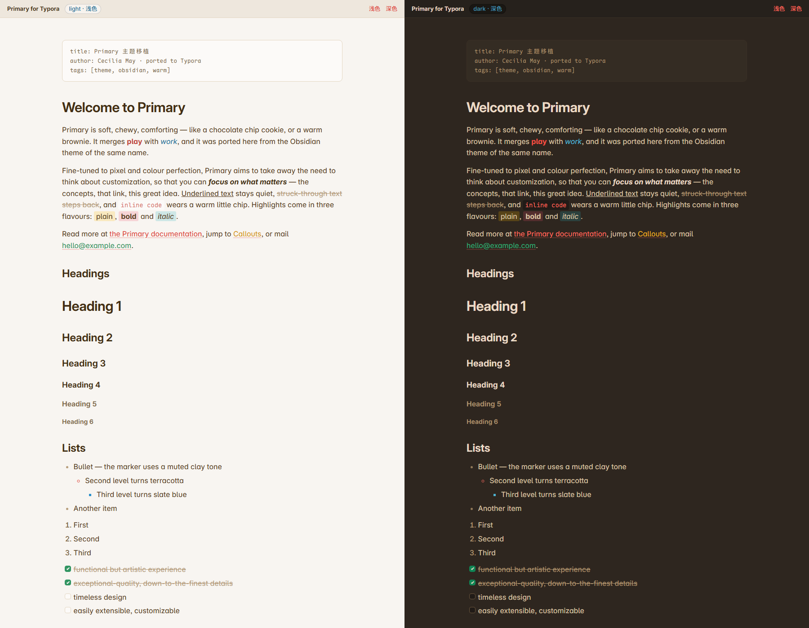
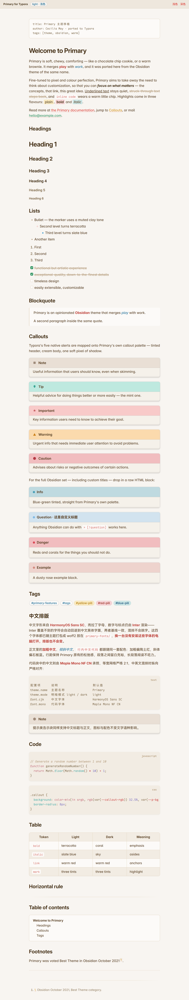
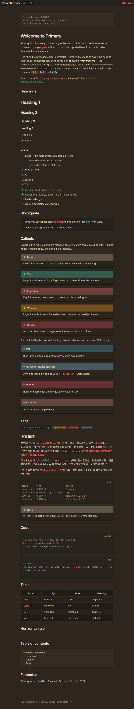
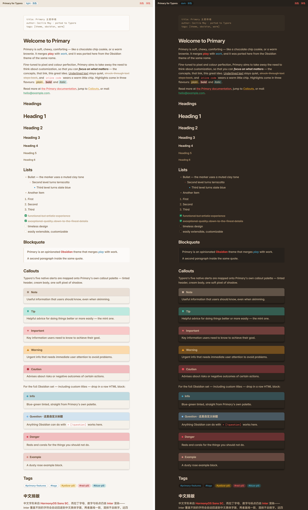

<div align="center">

[English](README.md) &nbsp;·&nbsp; **简体中文**

# Primary for Typora

**把 Cecilia May 的 Obsidian 主题 [Primary](https://github.com/primary-theme/obsidian) 移植到 Typora —— 温暖的纸张质感、陶土红点缀，原样保留。**

配色、排版、标志性的 callout、行内代码小片和标签胶囊一一对应；字体随主题一起打包，换一台没装过这些字体的电脑打开，排版也不会走样。

[](LICENSE)
[](https://typora.io)
[](#字体)
[](https://github.com/tangolee/primary-typora-theme/releases/latest)

[安装](#安装) · [截图](#截图) · [主题包含什么](#主题包含什么) · [光标动画](#光标动画) · [背景纹理](#背景纹理) · [自定义](#自定义) · [字体](#字体) · [仓库结构](#仓库结构) · [兼容性](#兼容性) · [许可](#许可)



</div>

---

## 安装

### 获取文件

**直接下发布包最省事：** [primary-typora-theme.zip](https://github.com/tangolee/primary-typora-theme/releases/latest/download/primary-typora-theme.zip) —— 六个 CSS 文件和 `primary-fonts/`，27.8 MiB，没有别的东西，解压就能用。

| 方式 | 做法 |
| --- | --- |
| **下载 ZIP** | [primary-typora-theme-main.zip](https://github.com/tangolee/primary-typora-theme/archive/refs/heads/main.zip) —— 主题、字体、演示文档和预览页全都在里面，约 30 MB |
| **克隆仓库** | `git clone https://github.com/tangolee/primary-typora-theme.git` |

### 复制到 Typora 的主题目录

把六个 CSS 文件和 `primary-fonts/` 复制到：

| 平台 | 主题目录 |
| --- | --- |
| Windows | `%APPDATA%\typora\themes` |
| macOS | `~/Library/Application Support/typora/themes` |
| Linux | `~/.config/typora/themes` |

最快的走法是 **文件 → 偏好设置 → 外观 → 打开主题文件夹**，然后把这些粘贴进去。

| 项目 | 是什么 |
| --- | --- |
| `primary.css` · `primary-dark.css` | 主题本身 |
| `primary-fonts/` | 打包字体 —— 八个 woff2 文件 |
| `primary-dots.css` · `primary-dots-dark.css` | 主题 **加上** Primary 的圆点纸 |
| `primary-grid.css` · `primary-grid-dark.css` | 主题 **加上** Primary 的横线纸 |
| `primary-LICENSE.txt` · `primary-FONTS.md` | 出处说明 —— GPL-3.0 许可与字体各自的条款；放不放都行 |

后四个是可选的纸张纹理，每个约 2 KB —— 不需要就不放，拿不准就留着。详见[背景纹理](#背景纹理)。

> `primary-fonts/` 必须和 CSS 文件**并排放在同一层** —— 样式表里的相对路径就指向那里。不装字体主题也能跑，但中文和代码会退回系统碰巧有的那个字体，而这正是打包字体要消除的那种不一致。

### 启用主题

**文件 → 偏好设置 → 外观 → 主题**，把主题下拉框设为 **Primary**。Typora 用文件名当主题名，把连字符换成空格，所以上面六个文件在列表里是 **Primary**、**Primary Dark**、**Primary Dots**、**Primary Dots Dark**、**Primary Grid**、**Primary Grid Dark**。

Typora **不会**自己把 `X` 和 `X-dark` 配成一对。要用深色版，勾上 **在深色模式下使用独立的主题**，再把 **深色主题** 设为 **Primary Dark**；之后系统配色一变，Typora 就在两者之间切换。不勾这个框，你选的那一个主题会在两种模式下都用。

为了得到设计时的效果，建议这样设置：

- **外观** —— 使用默认的 *一体化（Unibody）*，或 *极简（Minimal）* 窗口样式。
- **Markdown → 语法支持** —— 保持 *公式* 和 *图表* 开启，数学公式的排版样式才会生效。

### 更新与卸载

- **更新** —— 替换全部六个 CSS 文件即可；字体文件夹只在字体本身变动时才需要换。
- **卸载** —— 删掉这六个 CSS 文件和 `primary-fonts/`，再选回别的主题。没被选中的主题文件不会做任何事，所以纹理主题留着也不碍事。

---

## 截图

两套构建共用同一份令牌集，所以它们其实是同一个设计的两种温度 —— 暖白纸，或暖炭黑。

<details>
<summary><b>整页截图</b>（浅色 · 深色 · 并排对照）</summary>

<br>

**浅色** —— `docs/screenshot-light.png`



**深色** —— `docs/screenshot-dark.png`



**并排对照** —— `docs/screenshot-compare.png`



</details>

### 不安装也能先看

这些页面用任何浏览器打开即可，而且完全自包含 —— CSS 内联在文件里，字体从 `primary-fonts/` 读取：

| 文件 | 内容 |
| --- | --- |
| `docs/preview-light.html` · `docs/preview-dark.html` | 所有元素一览 |
| `docs/preview-demo-light.html` · `docs/preview-demo-dark.html` | 渲染好的演示文档 |
| `docs/probe-fallback.html` | 对照页：证明打包字体与系统已安装字体一致 |

> **预览页有一个前提要说清楚。** Typora 渲染时会把原始 HTML 里的 `class`、`id`、`data-*` 剥掉，导出时再放回来。这些页面是按**导出 / 打印**后的结果做的，所以下文那些 Obsidian 式 callout 在这里、以及导出的 HTML/PDF 里是带样式的 —— 但在编辑器里不是。编辑器里请使用 `> [!NOTE]` 写法，见 [Callout](#callout)。

---

## 主题包含什么

### 配色

整套色彩系统是用 Primary 自己的色阶重建的 —— 暖灰梯度再加上每一个具名色相，每色四档外加一个透明底纹 —— 所以没有任何一处是"近似"出来的：

- **浅色** —— 暖调米白纸色，深咖色标题，陶土红作为主强调色。
- **深色** —— 暖炭黑（绝不是纯黑），珊瑚色强调，整体色调柔化。
- 两套构建共用同一批令牌：原始色阶（`--p-gray-*`、`--p-red-*`、`--p-blue-*` 等）向上喂给语义令牌，例如 `--p-bg`、`--p-text`、`--p-text-title`、`--p-border`、`--p-link`、`--p-bold`、`--p-italic` 和 `--p-callout-*-rgb`。

### 排版与字体

主题使用四款字族，**四款全部打包**在 `primary-fonts/` 里（woff2），一个都不需要额外安装：

| 用途 | 字族 | 文件 | 体积 | 许可 |
| --- | --- | --- | --- | --- |
| 拉丁正文与界面 | **Inter**（可变） | `InterVar.woff2`、`InterVar-Italic.woff2` | 0.69 MiB | SIL OFL 1.1 |
| **中文（CJK）** | **HarmonyOS Sans SC** | `HarmonyOS-Sans-SC-{Regular,Bold}.woff2` | 8.28 MiB | 华为字体条款 |
| **代码** | **Maple Mono NF CN** | `MapleMono-NF-CN-{Regular,Bold,Italic}.woff2` | 18.47 MiB | SIL OFL 1.1 |
| 代码回退 | Cascadia Code（可变） | `CascadiaCode.woff2` | 0.19 MiB | SIL OFL 1.1 |

- Inter 排在字体栈最前面，拉丁字母、希腊字母和西里尔字母因此保持 Primary 设计时的度量。Inter 没有覆盖的字符 —— 也就是全部 CJK —— 会直接落到 **HarmonyOS Sans SC**，中文拿到的是一个正经设计过的字面，而不是系统随手挑的那个。
- 代码字体是 **Maple Mono NF CN**，Maple Mono 的中文版。它把中文字形放进同一套等宽网格里，严格 **2 : 1** —— 两个拉丁字符的宽度正好等于一个汉字。所以写在代码块里的表格中英文能对齐成列，这是原来的 Cascadia Code 做不到的，它完全没有 CJK 覆盖。
- 标题是半粗体，暖深棕，留白充裕；正文行高沿用 Primary 原本那份松弛的度量。

这两款 CJK 字族才是真正关系到可移植性的：全世界的系统都有**某种**中文字体，但没有两家的度量是一致的，不打包字面的话同一份文档在每台机器上都会长得不一样。详见[字体](#字体)。

### 强调

| 写法 | 浅色 | 深色 |
| --- | --- | --- |
| `**加粗**` | 陶土红 | 珊瑚色 |
| `*斜体*` | 石板蓝 | 天蓝 |
| `***两者***` | 近黑 | 近白 |
| `~~删除线~~` | 弱化 + 细线 | 弱化 + 细线 |
| `<u>下划线</u>` | 柔和 1.5px 下划线 | 柔和 1.5px 下划线 |
| `==高亮==` | 三档：普通 / 加粗 / 斜体 | 同左 |

### 链接

外链是 Primary 红，`[[维基式链接]]` 是赭黄，已解析的链接是绿色。下划线刻意做得很淡（约 22% 不透明度，1.5px）。

### 列表

三级项目符号依次走过陶土 → 陶土红 → 石板蓝。有序列表用 Primary 的柔化数字。任务列表的复选框是带圆角的小方块，勾选后填充 Primary 绿。

### Callout

两条路线，都按 Primary 的 callout 配方来做 —— **着色标题条 + 米色正文 + 一像素柔和阴影** —— 而且两条都不画侧边线，因为 Primary 的 callout 本来就是圆角的整块着色卡片。Typora 自带样式表会给原生 alert 加一条 GitHub 风格的 `border-left` 竖线，主题把它取消了。

**A. Typora 原生告示块**（兼容 GitHub / Obsidian 语法）—— 这条在编辑器里就有样式：

```markdown
> [!NOTE]
> Useful information that users should know, even when skimming.
```

`[!NOTE]` `[!TIP]` `[!IMPORTANT]` `[!WARNING]` `[!CAUTION]` 五种的配色都映射到 Primary 自己的 callout 色板，图标带对应色相承担强调，标题文字保持正文色。

**B. 通过原始 HTML 块使用完整的 Obsidian 集合。** Primary 为 Obsidian 的每一种 callout 都备了颜色，Typora 只有五种 alert，盖不住，所以主题也直接给 Obsidian 那套标记做了样式 —— 圆角卡片、着色标题条、以及一个同色相的小圆点：

```html
<div class="callout" data-callout="question">
  <div class="callout-title">Question · 自定义标题</div>
  <div class="callout-content"><p>这里随便写，包括 <code>行内代码</code>。</p></div>
</div>
```

> **编辑器与导出的区别。** Typora 渲染时会剥离用户 HTML 上的 `class`、`id` 和 `data-*`，导出时再恢复，所以路线 B 只对 **HTML / PDF 输出**生效。在编辑器里请用路线 A。

支持的 `data-callout` 取值：

`note` · `abstract` `summary` `tldr` · `info` · `todo` · `tip` `hint` · `important` · `success` `check` `done` · `question` `help` `faq` · `warning` `caution` `attention` · `failure` `fail` `missing` · `danger` `error` · `bug` · `example` · `quote` `cite`

> **关于 `caution` 的一点说明。** 两条路线各自遵循自己的约定，这是有意为之。路线 **B**（Obsidian 标记）里 `caution` 是 `warning` 的别名，和 Obsidian 完全一致；路线 **A** 里 Typora 原生的 `> [!CAUTION]` 沿用它继承自 GitHub 的语义，于是取 Primary 最强的那个红 —— 这也让它和紧挨着它上面的 `> [!WARNING]` 在视觉上区分得开。

### 标签

这里有两道坎要绕，两件事都值得说清楚。

**Typora 没有 hashtag 语法。** `#tag` 就是纯文本 —— 它从来不会变成一个元素，所以任何 CSS 选择器都够不着它。

**Typora 渲染时同样会剥离用户 HTML 上的 `class`、`id` 和 `data-*`。** 导出后它们会回来，但在编辑器里已经没了，所以 `<span class="tag">#tag</span>` 渲染出来就是一个没有任何样式的裸 span。这就是过去那套基于 class 的胶囊"看起来毫无作用"的原因。

可移植的出路是**用 Markdown 链接**。链接的 DOM 是 Typora 自己生成的，`href` 一定在，可以拿来选择 —— 把链接指向预留的 `#tag` 目标，它就变成一个胶囊：

```markdown
[#primary-features](#tag)   [#obsidian](#tag-1)   [#warm](#tag-3)
```

| 链接目标 | 胶囊 |
| --- | --- |
| `#tag` | 默认的中性胶囊 |
| `#tag-1` | Primary 的黄色底 |
| `#tag-2` | Primary 的红色底 |
| `#tag-3` | Primary 的蓝色底 |

`#tag*` 故意不是任何真实标题的 id，所以每个标签链接都是惰性的 —— 它纯粹作为一个样式钩子存在。如果目标是导出（HTML、PDF），基于 class 的写法同样有样式：

```html
<span class="tag">#primary-features</span>
<span class="tag tag-1">#yellow-pill</span>
```

### 代码

行内代码戴一枚 Primary 的暖色"小片"。围栏代码块坐落在暖调着色底面上，配一套从 Primary 色阶重新推导出来的完整语法配色 —— 关键字、字符串、数字、注释、函数、属性和标点，用的都是主题自己的色相，而不是什么通用主题的。

### 表格、分隔线及其余

- 表格：着色表头行、发丝细线、没有沉重网格。
- `<hr>` 画的是 Primary 那条居中的短横线。
- 数学公式（行内与块级）、脚注、图片、`[TOC]`、以及渲染成柔和凸起卡片的 YAML front matter，都有样式。
- 侧边栏、大纲、文件树、标题栏、菜单、弹窗、滚动条、专注模式和打印/导出也都做了主题化，整个应用保持一致。

---

## 光标动画

Typora 画光标的方式有两种，天花板差得很远。主题在各自允许的范围内做到最多。

| | 实时预览正文 | 源码模式、代码块、公式块 |
| --- | --- | --- |
| 由谁绘制 | 浏览器自己的光标 | CodeMirror —— 一个真实存在的、绝对定位的 `div.CodeMirror-cursor`，用 `border-left` 画出来 |
| 改颜色 | 可以 | 可以 |
| 淡入淡出 | 可以 | 可以 |
| **滑行移动** | **不行，物理上做不到** | **可以** |
| 所在位置 | `19 · CARET` 一节的 `@supports (caret-animation: manual)` 块 | `19 · CARET` 一节的 `.CodeMirror` 块 |

**实时预览里的光标不可能滑行。** 那个光标是浏览器自己的；`caret-color` 是唯一能碰到它的属性，没有任何办法移动它或改变它的形状。所以主题只给它 CSS 还能给的那一个效果 —— 柔和淡出。在引擎支持 `caret-animation: manual` 的地方，主题把闪烁从引擎手里接管过来，免得它和淡出打架；在不支持的地方，整个块被 `@supports` 跳过，Typora 自己的光标原样保留。

**代码块、公式块和源码视图是真能滑行的。** 它们跑在 CodeMirror 上，那里的光标是一个普通元素，`left`、`top`、`height` 都由 CodeMirror 在每次按键时重写。给这几个属性挂上 `transition`，跳变就变成了滑动 —— VSCode-Animations 用的就是这一招。

### 三种预设

它们的差别只在于 `--p-caret-fade` 指向哪里：

| 预设 | `--p-caret-fade` | 效果 |
| --- | --- | --- |
| `phase`（默认） | `transparent` | 光标完全淡出，再淡回来 |
| `breathe` | `var(--p-caret-color-soft)` | 只是变暗，从不会真的消失 |
| `solid` | `var(--p-caret-color)` | 完全不闪，常亮 |

```css
:root {
  --p-caret-color: var(--p-red-30);  /* 光标颜色                        */
  --p-caret-fade:  transparent;      /* 淡出到的那一端                  */
  --p-caret-width: 2px;              /* CodeMirror 光标的线宽           */
  --p-caret-glide: 70ms;             /* 写 0s 就退回瞬移                */
  --p-caret-blink: 1.1s;             /* 一个完整周期                    */
}
```

想彻底关掉动画，把下面这段追加到自定义样式表里：

```css
#write { animation: none; caret-animation: auto; }
.CodeMirror div.CodeMirror-cursor { transition: none; animation: none; }
```

在 `prefers-reduced-motion: reduce` 下，淡出和滑行都会被丢弃，光标改为常亮。

---

## 自定义

所有的可调项都在 CSS 文件顶部的 `01 · ROOT VARIABLES` 块里。最常用的几个：

```css
:root {
  --p-bg:              /* 页面背景                */
  --p-text:            /* 正文颜色                */
  --p-text-title:      /* 标题                    */
  --p-text-muted:      /* 次级文字、代码框架       */
  --p-border:          /* 发丝线                  */
  --p-link:            /* 链接颜色                */
  --p-bold:            /* **加粗**                */
  --p-italic:          /* *斜体*                  */
  --p-hl-yellow:       /* ==高亮== 的底色          */
  --p-callout-opacity: /* callout 着色的浓度       */
  --p-font-text:       /* 正文字体栈              */
  --p-font-mono:       /* 代码字体栈              */
  --p-caret-*          /* 见上                    */
}
```

因为两套构建共用同一份令牌集，**只改 `primary.css` 里的令牌不会影响 `primary-dark.css`** —— 想让改动跟着模式切换走，两边都要改。

### 把 callout 的彩色左边线加回来

如果你更喜欢 GitHub 那种观感，主题是有意取消了自带左边线的。把下面这段追加到 CSS 文件尾部就能加回来：

```css
/* 用 callout 自己的色相画侧边线 */
#write .md-alert,
#write .callout { border-left: 4px solid rgb(var(--callout-rgb, var(--callout-color))); }

/* 或者保留 Typora 那五种 GitHub 配色 */
#write .md-alert { border-left: .25em solid #000; }
#write .md-alert.md-alert-note      { border-left-color: #0969da; }
#write .md-alert.md-alert-important { border-left-color: #8250df; }
#write .md-alert.md-alert-warning   { border-left-color: #9a6700; }
#write .md-alert.md-alert-tip       { border-left-color: #1f883d; }
#write .md-alert.md-alert-caution   { border-left-color: #cf222e; }
```

`#write` 前缀是必须的，这样规则才能压过主题自己写的 `border: none`。

### 背景纹理

Primary 自带一张标志性的纸张纹理 —— 圆点纸或横线纸。它原来是主题 CSS 靠下的两个注释块，想打开就得先打开那个文件、动手写 CSS。为了一个观感付出这个代价不划算，所以它现在是四个小主题：

| 菜单里的主题 | 文件 | 纸面 |
| --- | --- | --- |
| **Primary Dots** | `primary-dots.css` | 每 50 px 一个 1 px 圆点 |
| **Primary Dots Dark** | `primary-dots-dark.css` | 同上，改用深色配色 |
| **Primary Grid** | `primary-grid.css` | 每 50 px 一条 1 px 线，两个方向都有 |
| **Primary Grid Dark** | `primary-grid-dark.css` | 同上，改用深色配色 |

把文件放进主题文件夹，在 **外观 → 主题** 里挑一个就行 —— 整个流程到此为止，不用编辑，也不用取消注释。

如果还想往下改，有两件事值得知道：

- **它们是 import，不是复制。** 每个约 2 KB，开头就是 `@import url("./primary.css")`，所以纹理主题永远不会和它所属的主题脱节。唯一的条件是 `primary.css` 得待在它旁边。
- **墨色是混出来的，不是挑出来的。** 两种纹理都画 `color-mix(in srgb, var(--p-text) 15%, transparent)` —— 横线用 6%，因为它落在页面上的墨比圆点场多得多。用正文色来混是刻意的：两套配色的色阶都是从 10（最浅）排到 140（最深），同一个灰色数值会在两种构建里落到页面背景的两侧，没有任何一档能同时对上。真正消费这个变量的是主题里的 `20 · BACKGROUND PATTERN` 一节，而 `--p-bg-pattern` 默认是 `none`，所以光用 `primary.css` 渲染出来的东西和以前一模一样。

想改纹理本身而不是挑一款 —— 换更宽的间距、更淡的墨 —— 改纹理文件里的 `--p-bg-pattern-size` 和 `--p-pattern-ink` 即可。如果不想多带一个文件，同样的事情也可以追加到 `primary.css` 末尾：

```css
content, #write {
  background-image: radial-gradient(circle, color-mix(in srgb, var(--p-text) 15%, transparent) 1px, transparent 1px);
  background-size: 50px 50px;
}
```

这样可行，但升级时不会保留 —— 见[更新与卸载](#更新与卸载)。

## 字体

四款字族全部放在 `primary-fonts/` 里 —— **八个 woff2 文件，27.6 MiB**。每一个的声明方式都是有意安排的：

| 字族 | 声明方式 | 换来什么 |
| --- | --- | --- |
| **HarmonyOS Sans SC** | 先 `local()`，再打包文件 | 机器上已经装了这款字体时，那 8.3 MiB 根本不会被读取 |
| **Maple Mono NF CN** | 先 `local()`，再打包文件 | 机器上已经装了这款字体时，那 18.5 MiB 根本不会被读取 |
| **Inter** | 只用打包文件 | 0.69 MiB，直接读比来回协商更划算 |
| **Cascadia Code** | 只用打包文件 | 0.19 MiB，而且它是一个很少被走到的回退 |

不需要安装、也不需要下载：这就是一个桌面应用在读本地文件。

打包的 woff2 是字体本身的重新封装，`gasp` 和 hinting 表都保留了，没有为了压缩体积而删表。每一个文件的来源、各自的许可、以及重新生成或彻底放弃字体包的做法，都写在 `FONTS.md` 里。

---

## 仓库结构

最前面七项就是主题本身，`docs/` 里的全是文档资料 —— 想看就看，不看也无所谓，装主题只需要复制 CSS 文件和字体文件夹。

```text
primary-typora-theme/
├── primary.css            浅色构建 —— 整个主题，也是你要改的那个文件
├── primary-dark.css       深色构建，同一份令牌集
├── primary-dots.css       浅色构建 + 圆点纸    ┐
├── primary-dots-dark.css  深色构建 + 圆点纸    │  可选的背景纹理
├── primary-grid.css       浅色构建 + 横线纸    │  主题，每个约 2 KB
├── primary-grid-dark.css  深色构建 + 横线纸    ┘
├── primary-fonts/         八个 woff2 文件，必须和 CSS 放在同一层
├── docs/                  安装时用不到 —— 里面是：
│   ├── primary-demo.md        演示文档：所有元素集中在一个文件里
│   ├── preview-*.html         自包含的浏览器预览页
│   ├── probe-fallback.html    字体回退对照页
│   └── screenshot-*.png       上文用到的截图
├── FONTS.md               字体来源、许可与验证
├── README.md
├── README.zh-CN.md
└── LICENSE                GPL-3.0
```

---

## 兼容性

- **Typora 1.x**，Windows / macOS / Linux 均可。这些 CSS 文件都是普通的 CSS 自定义属性样式表 —— 没有构建步骤、没有预处理器、没有 JavaScript。
- **光标淡出需要 `caret-animation`**（Chromium 140 或更新）。在更老的运行时上，`@supports` 会把这个块丢掉，其余部分不受影响。
- **纹理主题用的是 `@import`**，浏览器会相对主题文件本身去解析它 —— 已经有好几个公开的 Typora 主题靠同一个机制加载自己的字体。Typora 在导出时也会跟着展开，所以导出的 CSS 同样带上纹理。唯一的规矩是 `primary.css` 得待在它们旁边。
- **原始 HTML 的样式只在导出时生效。** Typora 的渲染器会移除用户 HTML 上的 `class` / `id` / `data-*`，在导出或打印时再放回去。主题的写法保证编辑器里不依赖它们：标签走 Markdown 链接，Obsidian callout 是在五种原生 alert 之上叠的一层导出时素材。
- **五种告示块，一整套 callout 色板。** Typora 只解析 `[!NOTE] [TIP] [IMPORTANT] [WARNING] [CAUTION]`；Primary 提供的其余每一种 callout 颜色都可以通过上文的路线 B 拿到。
- **下载内容里几乎全是字体。** 如果你不想背着这 27.6 MiB，删掉 `primary-fonts/` 和 `@font-face` 块即可，其余部分照常工作。

---

## 许可

上游 Primary 主题以 **GNU 通用公共许可证 v3.0** 发布。本 Typora 移植是衍生作品 —— 它沿用了 Primary 的设计与色阶 —— 因此同样以 **GPL-3.0** 发布。许可证副本见 [`LICENSE`](LICENSE)。

对一个主题而言，实际含义是：随便用、随便改、随便分享 —— 但如果你分发的是修改过的版本，它也必须保持在 GPL-3.0 之下。

打包的字体是另一回事：

| 字体 | 许可 | 打包分发 |
| --- | --- | --- |
| Inter | SIL OFL 1.1 | 允许，原样再分发 |
| Cascadia Code | SIL OFL 1.1 | 允许，原样再分发 |
| Maple Mono NF CN | SIL OFL 1.1 | 允许，原样再分发 |
| HarmonyOS Sans SC | 华为自家的字体条款（可免费使用，含商用） | 见 `FONTS.md` 里的注意事项 |

**公开再分发本主题之前请先读 [`FONTS.md`](FONTS.md)** —— 里面列了每个文件的来源，并标注了唯一一款条款不是 OFL 的字族。

## 致谢

- 原始主题：**[Primary](https://github.com/primary-theme/obsidian)**，作者 Cecilia May —— Obsidian October 2021 最佳主题得主。设计上的功劳全部归于她，没有它就没有这个移植。
- 本仓库打包的字体，全部原样再分发：**Inter**（Rasmus Andersson）、**Cascadia Code**（Microsoft）、**Maple Mono NF CN**（subframe7536），均为 SIL OFL 1.1；以及华为的 **HarmonyOS Sans SC**。详见 [`FONTS.md`](FONTS.md)。
- 本仓库中的 Obsidian→Typora 选择器映射、两套配色、alert/callout 桥接、光标动画、字体打包与预览工具，都是原创工作。

---

发现哪里不对，或者在你机器上 Typora 把某个选择器渲染成了别的样子？[提个 issue](https://github.com/tangolee/primary-typora-theme/issues) —— 附上截图和 Typora 版本会很有帮助。
